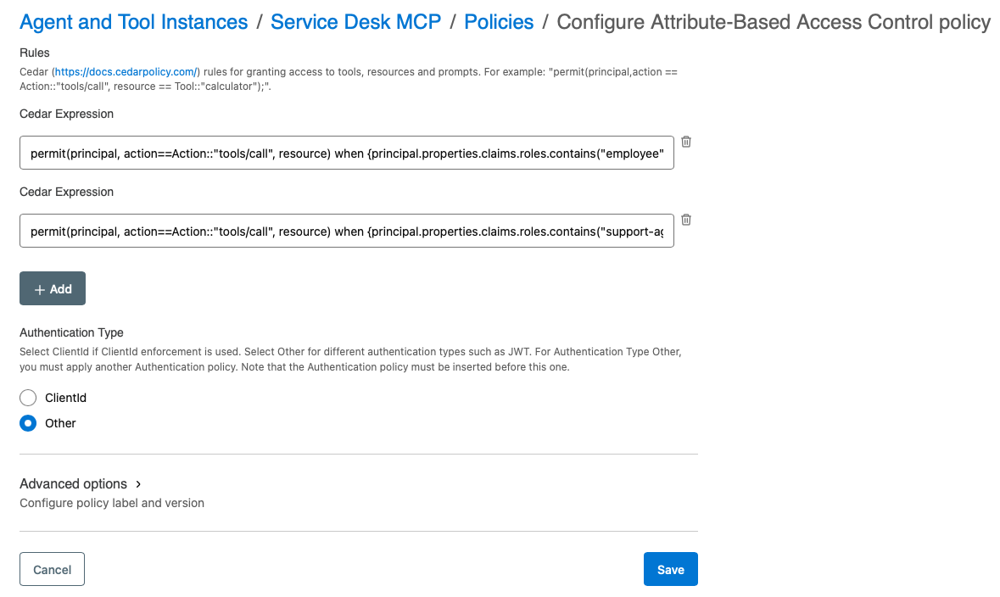
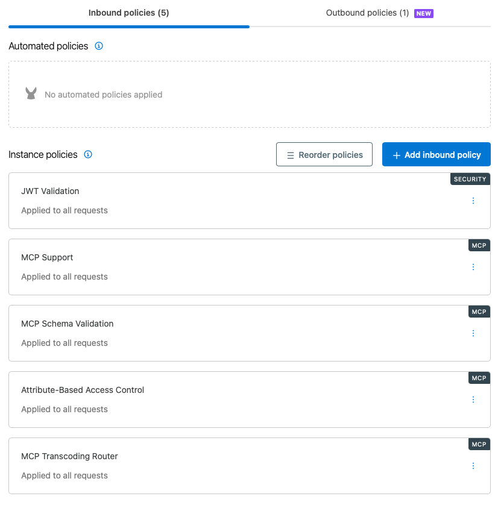

# MCP Authorization

This document describes the implementation and testing of tool-level authorization for MCP clients accessing the Service Desk API through MuleSoft Omni Gateway.

The MCP Attribute-Based Access Control (ABAC) policy requires an authentication mechanism to establish the caller’s identity and attributes. This implementation uses JWT authentication, configured through the JWT Validation policy as described in [JWT Authentication](jwt-authentication.md)⁠. MCP ABAC evaluates claims from the authenticated JWT to determine which MCP tools the client may invoke.

## MCP ABAC Configuration

The MCP ABAC policy is configured with three separate Cedar expressions, one for each persona: Employee, Support Agent, and Administrator. Each expression evaluates the authenticated JWT’s `roles` claim and grants access to the corresponding MCP tools. The Authentication Type is set to `Other` because authentication is provided by the JWT Validation policy.



**Scope:** This implementation enforces tool-level authorization only. Record-level authorization, such as restricting access to incidents owned by the caller, was not implemented or validated.

### Policy Ordering

The following inbound policy order was used during authorization testing:

1. JWT Validation
2. MCP Support
3. MCP Schema Validation
4. Attribute-Based Access Control
5. MCP Transcoding Router



> [!NOTE]
> Testing demonstrated that:
>
> 1. The JWT Validation policy must precede the MCP-related policies to enforce authentication.
> 2. The Attribute-Based Access Control policy successfully enforced authorization when positioned after MCP Schema Validation and before MCP Transcoding Router.

## Employee Persona

The Employee JWT includes the claim:

```json
{"roles": ["employee"]}
```

The Employee persona may list, retrieve, and create incidents, and add comments. Assignment, deletion, and general incident updates are not permitted.

| MCP Tool | Employee Permission |
| --- | --- |
| `list_incidents` | Allow |
| `get_incident` | Allow |
| `create_incident` | Allow |
| `add_incident_comment` | Allow |
| `assign_incident` | Deny |
| `delete_incident` | Deny |
| `update_incident` | Deny |

### Cedar Policy

The policy is maintained in [`policies/employee.cedar`](../policies/employee.cedar):

```cedar
permit(
    principal,
    action == Action::"tools/call",
    resource
)
when {
    principal.properties.claims.roles.contains("employee") &&
    [
        Tool::"list_incidents",
        Tool::"get_incident",
        Tool::"create_incident",
        Tool::"add_incident_comment"
    ].contains(resource)
};
```

The expression permits `tools/call` only when the authenticated principal has the `employee` role and the requested tool appears in the permitted set. Tool invocations not explicitly permitted by the Cedar expression are denied.

> [!NOTE]
> The API Manager Cedar editor accepts the expression on a single line. The repository retains the formatted version for readability.

## Support Agent Persona

The Support Agent JWT includes the claim:

```json
{"roles": ["support-agent"]}
```

The Support Agent persona may perform all Employee operations, as well as assign and update incidents. Incident deletion is not permitted.

| MCP Tool | Support Agent Permission |
| --- | --- |
| `list_incidents` | Allow |
| `get_incident` | Allow |
| `create_incident` | Allow |
| `add_incident_comment` | Allow |
| `assign_incident` | Allow |
| `delete_incident` | Deny |
| `update_incident` | Allow |

### Cedar Policy

The policy is maintained in [`policies/support-agent.cedar`](../policies/support-agent.cedar):

```cedar
permit(
    principal,
    action == Action::"tools/call",
    resource
)
when {
    principal.properties.claims.roles.contains("support-agent") &&
    [
        Tool::"list_incidents",
        Tool::"get_incident",
        Tool::"create_incident",
        Tool::"add_incident_comment",
        Tool::"assign_incident",
        Tool::"update_incident"
    ].contains(resource)
};
```

The expression permits `tools/call` only when the authenticated principal has the `support-agent` role and the requested tool appears in the permitted set. Incident deletion is denied.

## Administrator Persona

The Administrator JWT includes the claim:

```json
{"roles": ["administrator"]}
```

The Administrator persona may invoke all seven MCP tools, including incident deletion.

| MCP Tool | Administrator Permission |
| --- | --- |
| `list_incidents` | Allow |
| `get_incident` | Allow |
| `create_incident` | Allow |
| `add_incident_comment` | Allow |
| `assign_incident` | Allow |
| `delete_incident` | Allow |
| `update_incident` | Allow |

### Cedar Policy

The policy is maintained in [`policies/administrator.cedar`](../policies/administrator.cedar):

```cedar
permit(
    principal,
    action == Action::"tools/call",
    resource
)
when {
    principal.properties.claims.roles.contains("administrator") &&
    [
        Tool::"list_incidents",
        Tool::"get_incident",
        Tool::"create_incident",
        Tool::"add_incident_comment",
        Tool::"assign_incident",
        Tool::"update_incident",
        Tool::"delete_incident"
    ].contains(resource)
};
```

The expression permits `tools/call` only when the authenticated principal has the `administrator` role and the requested tool appears in the permitted set.

## Authorization Testing

Authorization was validated using the Bruno collection in [`api-requests/`](../api-requests/). The collection exercises all seven MCP tools against the Employee, Support Agent, and Administrator personas.

Each persona creates a test incident and stores its identifier in the Bruno runtime variable `incidentId`. Subsequent operations, including denied operations, reference that incident to ensure authorization behavior is evaluated independently of incident existence.

The collection uses JavaScript assertions to verify successful MCP tool execution and expected authorization denials.

| Persona | Permitted | Denied | Result |
| --- | ---: | ---: | --- |
| Employee | 4 | 3 | All passed |
| Support Agent | 6 | 1 | All passed |
| Administrator | 7 | 0 | All passed |
| **Total** | **17** | **4** | **21 passed** |

The Bruno collection also includes four JWT authentication scenarios covering missing, valid, expired, and incorrect-audience tokens, bringing the total to 25 requests.

### Denied Invocation Response

Denied tool invocations returned an HTTP `200 OK` response containing a JSON-RPC error. For example, `delete_incident` returned:

```json
{
  "jsonrpc": "2.0",
  "id": 2,
  "error": {
    "code": -32008,
    "message": "Unable to access",
    "data": "Access denied to: \"delete_incident\""
  }
}
```

Authorization tests must therefore inspect the JSON-RPC response body rather than relying on the HTTP status alone.

### Tool Discovery

A `tools/list` request using the Employee JWT returned the complete catalog of seven tools, including those the Employee could not invoke. The Support Agent JWT was also used to test tool discovery.

> [!NOTE]
> **Finding:** In the tested configuration, MCP ABAC restricts tool invocation but does not filter the catalog returned by `tools/list`. Unauthorized tools remain discoverable and are denied when invoked.

All three personas—Employee, Support Agent, and Administrator—have been implemented and validated through the Bruno collection. The authorization model enforces tool-level access controls using JWT role claims and Cedar expressions configured in the MCP ABAC policy.
